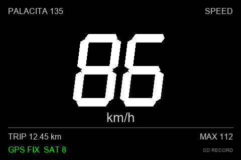
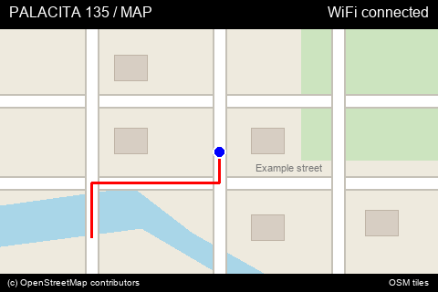
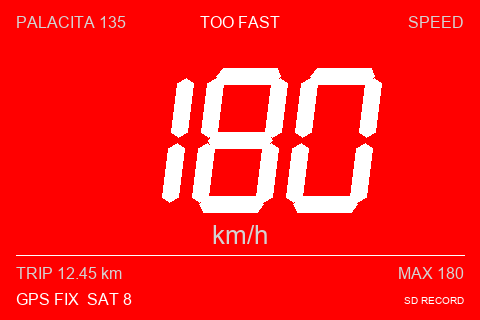

# PALACITA 135 ESP32 GPS speedometer

Standalone Arduino/PlatformIO firmware configured for **ESP32-3248S035**
(ESP32-WROOM, 480x320 ST7796 TFT, backlight GPIO27). The GPS module
supplies speed over UART; the Accord's ECU and OBD1 wiring are not involved.
An OBD adapter is not required for this project. Engine RPM, coolant readings,
and ECU diagnostics would be a separate, vehicle-specific interface project.

## Screen examples

Illustrative previews of the 480x320 screens, using sample GPS/session values.
Text approximates the TFT fonts; these are not photographs or hardware captures.
The MAP background below is a synthetic street diagram, not an actual location.
On the device, street tiles come from OpenStreetMap around a valid GPS position.

### SPEED



### MAP



Your current position is blue with a white border. It turns orange after
2.5 seconds without a fresh position. The session track is red; GPS outages
leave gaps. Press BOOT briefly to switch between SPEED and MAP.

### Speed warning: 180 km/h or higher



With fresh speed at or above 180 km/h, the background alternates red/black
every 400 ms while the speed stays white and `TOO FAST` appears. MAP switches
back to SPEED during the warning. A [static red-phase preview](docs/images/speed-warning.png)
is also available. Regenerate previews with `python scripts/generate-ui-previews.py`
(requires Pillow).

## Features

- Static full-screen color `palacj.png` boot splash for three seconds.
  GPS parsing and SD logging continue while the image is visible.
- Full-screen 480x320 UI with centered, double-size speed digits, 5 Hz screen
  refresh and receiver-paced measurements.
- Speed uses white, bold, slanted racing-style vector digits. At GPS speeds of
  180 km/h or higher the full-screen background flashes red/black every 400 ms
  with `TOO FAST`; white digits remain visible. Invalid/stale speed stops the
  warning and shows white `0`; the GPS status distinguishes no fix from a
  measured zero speed.
- GPS speed from checksum-valid GPRMC/GNRMC sentences, knots converted to km/h.
- `0` immediately after an RMC void fix, or after 2.5 seconds without valid speed.
- Satellite count from fresh GGA data; missing/stale counts show `--`.
- Session trip distance integrated from speed, and session maximum speed.
- Press BOOT to switch SPEED / MAP. Hold it for two seconds to reset
  trip/max **only with a fresh zero-speed reading**; release it before powering
  up or resetting. Touch is disabled until the R/C variant is confirmed.
- 2.4 GHz Wi-Fi hotspot setup and on-device OSM street map, with live GPS
  marker and a simplified session route. Bluetooth disabled.
- Automatic SD CSV track per boot: WGS84 longitude/latitude, GPS UTC, elapsed
  milliseconds, recent GGA altitude, altitude age and raw GPS speed.

The live map holds its last position while the filtered speed is zero, reducing
parked position drift. SD recording still saves raw valid GPS samples while
stationary. This is not a guarantee of motion detection: poor GPS reception can
report speeds above the cutoff even when parked. Serial diagnostics include
satellites, HDOP and raw speed to help assess reception.

The PNG decoder is allocated only while drawing a cached tile and released
before HTTPS downloads. Decoding pauses while a download is in progress so
the inflate buffer and TLS handshake do not compete for limited ESP32 RAM.
HTTPS tile bodies are passed to the main loop in chunks of at most 2 KB and
written to `/tiles/*.png.part`. The one-item queue limits buffered chunks;
the complete PNG is never allocated in RAM. Only a complete response with a
PNG signature is promoted to the cache; failed partial files are removed.

Trip/max reset at power-off and are not a persistent odometer. Trip omits GPS
outages; it will undercount distance in tunnels. There is no position processing
or map projection in the speed display: this uses the receiver's reported ground speed directly.
The configurable 2 km/h deadband reduces stationary creep, but hides movement
below that threshold. No additional smoothing is used, to avoid adding lag.

## Hardware and wiring

Use a GPS breakout with an antenna, documented power input, **3.3 V UART TX**,
and NMEA RMC output. NEO-6M and ATGM336H breakouts can be used if their actual
voltage, baud rate, and sentence output match. Do not infer breakout voltage
from its module name. A bare NEO-6M is a 2.7–3.6 V part; some carrier boards
have a regulator and a different VCC requirement.

| GPS connection | CYD connection |
| --- | --- |
| TX, 3.3 V logic | P3 **IO35** (ESP32 UART2 RX) |
| GND | CN1 **GND**, common with P3 GND |
| VCC | CN1 **3.3V**, only for a breakout supporting that supply |
| RX, 3.3 V logic | P3 **IO22** (ESP32 UART2 TX) |

Power the CYD through its USB socket with regulated **5 V**. Use a separate
appropriate GPS supply branch if needed. For a breakout explicitly specified
for 3.3 V, a verified 3V3 supply pin is an option only after checking its current requirement and
the CYD regulator's available margin; do not assume every NEO-6M carrier will
run correctly from 3.3 V at its VCC pin.

Identify connector pins by board markings/continuity, not wire colors or a
left-to-right drawing: connector orientation and board revisions differ.
GPIO35 is input-only, suitable for UART RX. GPIO27 is the display backlight.
GPIO21 can be used by capacitive touch and is not assumed spare.
GPIO22 is enabled as UART2 TX and can connect to GPS RX. UART2 runs at
9600 baud, 8-N-1. The firmware receives NMEA and does not currently send
receiver configuration commands; connecting GPS RX makes that direction
available without changing the receiver settings. No ESP32 signal pin may
receive 5 V or vehicle 12 V.

Display: ST7796, MISO12, MOSI13, SCLK14, CS15, DC2, BL27, HSPI.
The 480x320 landscape SPEED UI is drawn through a 480x40 4-bit strip sprite
(9,600 bytes) with an explicit palette. Each strip is composed off-screen and
pushed without first blanking the LCD. This reduces RAM demand when Wi-Fi is
enabled. If even the strip cannot be allocated, direct drawing remains available.
SD uses VSPI: CLK18, MISO19, MOSI23, CS5, at 10 MHz.
Touch variants differ: R uses XPT2046; C uses GT911. Touch initialization and
polling are disabled by default. Do not enable the old 2.8-inch touch pin setup
without verifying your board's controller and pins.

## Power and mounting in the car

For the first installation, use a reputable automotive 12 V-to-5 V USB adapter
in the accessory socket, with output capacity of at least 1 A and suitable
operating temperature. Bench-test with a USB supply first.

For a permanent installation, use a fused ignition-switched accessory feed and
an automotive-qualified protected converter, then regulated 5 V to CYD USB.
Size the fuse to protect the selected wire and converter; install it near the
feed. The converter needs specified reverse-polarity, surge/load-dump, and
short-circuit protection. A generic bench buck module's nominal input voltage
rating alone does not establish automotive transient protection. Cranking may
cause a restart unless the converter supports the required low input voltage.
Avoid connecting a PC USB supply and a separate CYD VIN supply simultaneously.

Place the GPS antenna with a clear sky view, away from switching power wiring;
test the chosen windshield location before fixing it in place. Secure the CYD
and wiring outside the driver's sightline, controls, and airbag deployment
areas. Use a heat-resistant enclosure and verify dashboard temperatures. Keep
the original instrument cluster: GPS is unavailable indoors/tunnels and has
acquisition time and measurement latency. Treat this as an auxiliary display.

## Build and flash

Install PlatformIO Core or the VS Code PlatformIO extension. From this folder:

```powershell
pio run
pio device list
pio run -t upload --upload-port COM5
pio device monitor --port COM5 --baud 115200
```

Replace COM5 with the actual CYD port. Uploading is a separate action; a build
does not flash the board. Release BOOT for normal power-up.

### Upload fails with `Wrong boot mode detected (0x13)`

The firmware built successfully, but the ESP32 booted normally instead of
entering its ROM download mode. Changing application code cannot fix this
boot-mode selection; the application has not been uploaded yet.

1. Close any serial monitor using the CYD port.
2. Press and hold **BOOT**.
3. While holding BOOT, press and release **RESET/EN** if your board has it.
4. Keep holding BOOT and start the upload (use your actual port):

   ```powershell
   & "$env:USERPROFILE\.platformio\penv\Scripts\platformio.exe" run --target upload --upload-port COM3
   ```

5. Release BOOT when the log advances past `Connecting...` to chip information
   or flash writing. Wait for upload success; release BOOT before any reset.

If there is no RESET/EN button, hold BOOT while reconnecting USB, then upload
with BOOT still held. If the error persists, disconnect external peripherals,
verify the port with `pio device list`, and retry the sequence. External wiring
must not force GPIO0 high or GPIO2 high during download-mode reset. The CYD's
built-in display wiring should stay in place.

See [Espressif's upload troubleshooting](https://docs.espressif.com/projects/esptool/en/latest/esp32/troubleshooting.html)
for automatic-reset circuit checks. A lower upload baud rate can help transfer
errors, but does not select download mode.

If VS Code reports missing `SPI.h`, `Print.h`, or `WiFi.h`, open this entire
project folder (the folder containing `platformio.ini`) and install the
recommended PlatformIO IDE extension. Generate its ESP32 include paths with:

```powershell
pio project init --ide vscode
```

Then run **Developer: Reload Window** from the VS Code command palette. If
diagnostics remain stale, run **C/C++: Reset IntelliSense Database**. PlatformIO
generates `.vscode/c_cpp_properties.json` with the framework, library, compiler
paths and build defines; regenerate it after configuration changes instead of
manually adding individual Arduino headers.

Adjust `include/config.h` for GPS baud, orientation, deadband and brightness.
`splash_ms` sets static splash duration (default 3000 ms). `palacj.png` is
embedded in flash as a 480x320 256-color image, expanded to RGB565 one row at
a time. No SD image or full-frame splash RAM buffer is needed. The three-second
display begins after SD initialization. After replacing `palacj.png`, regenerate
with `python scripts/generate-splash.py` (requires Pillow) and rebuild. The
script also writes `.pio/splash-preview.png` as a static preview.
The default is **9600 baud, 8N1**, with a stale timeout suitable for 1 Hz output.
A 5 Hz receiver reduces measurement delay, but must be configured separately;
this firmware does not send GPS configuration commands. Confirm that the baud
rate can carry its enabled NMEA sentences. GP/GN talkers are supported; other
talker IDs or proprietary messages require a decoder change.

Display driver and pins are set in `platformio.ini`, so no globally installed
TFT_eSPI files need editing. ILI9341, ST7789, ESP32-S3 and other CYD variants
need different configuration. Confirm your PCB revision before flashing.
The TFT_eSPI warning about undefined TOUCH_CS is expected: its integrated
touch support is unused. BOOT controls are enabled; touch is currently disabled.

### Firmware runs but LCD stays black

If serial prints `GPS speedometer` and periodic `bytes=...` lines, the
application is running. Missing GPS data does not prevent the UI from drawing.
Close the serial monitor and upload the display-only diagnostic:

```powershell
& "$env:USERPROFILE\.platformio\penv\Scripts\platformio.exe" run -e cyd-display-test -t upload --upload-port COM3
```

This uses the same ST7796 configuration, holds backlight GPIO27 HIGH without
PWM, and draws red/green/blue/white screens every two seconds. It bypasses GPS,
touch and sprite allocation. Serial logs report each requested color; they
do not prove that the LCD received it.

Report whether colors appear, whether the backlight glows, and the exact PCB
model/revision and USB socket count. A black diagnostic screen requires checking
the actual LCD controller/pins and backlight hardware; do not select a different
driver solely from USB socket count.

Restore the speedometer after testing:

```powershell
& "$env:USERPROFILE\.platformio\penv\Scripts\platformio.exe" run -e cyd -t upload --upload-port COM3
```

## Hotspot and MAP page

Short-press BOOT to alternate SPEED and MAP (replaces DAY/NIGHT). Brightness is
the configured day level. Hold BOOT for two seconds for the existing stopped-only
trip/max reset. An active 180 km/h warning returns to SPEED so the red warning
remains visible. MAP is north-up, follows your position while moving, and uses fixed zoom 16;
there is no pan, zoom, route planning, Strava upload or account integration.

1. Insert a FAT32 microSD before power-on.
2. Enable a **2.4 GHz WPA2** smartphone/modem hotspot.
3. Flash the firmware and short-press BOOT to open MAP.
4. When no credentials are configured, MAP shows the
   **PALACITA-SETUP** Wi-Fi network and its randomly generated password.
5. Join that network from a phone/laptop and open **http://192.168.4.1**.
   Enter your hotspot SSID/password and press Connect.
6. Re-enable the phone hotspot if joining the setup network turned it off.
   ESP32 remembers credentials in NVS and reconnects on subsequent boots.
   The setup server and AP stop when the hotspot connects.
7. Outdoors, wait for a valid RMC position. The blue marker is your recent
   position; orange indicates a stale last-known position. A red line is the
   session route and does not connect across invalid fixes or GPS outages.

Configured hotspots are retried every 15 seconds, including when the phone
hotspot starts after the ESP32. MAP shows hotspot-not-found, authentication,
or handshake failures; the 115200-baud serial monitor prints the disconnect
reason and the IP/channel/signal strength on connection. Wi-Fi modem sleep is
disabled for connection stability and map latency, increasing power use.
For a missing hotspot, check that its band is 2.4 GHz and security is WPA2
rather than WPA3-only. To replace saved credentials using the portal, remove
any local build override and erase flash before uploading (also erases trip
settings stored in NVS).

Setup credentials are not committed or printed to serial. NVS is device storage,
not encrypted credential storage by default. Configure while parked; setup HTTP
is on the password-protected local AP, not a public web service.

An optional include/wifi_credentials.local.h can define PALACITA_WIFI_SSID and
PALACITA_WIFI_PASSWORD to automatically configure a local firmware build. This
file is Git-ignored; the credentials are embedded in that firmware and saved to
device NVS. Local definitions override provisioned values on each boot; remove
the file and rebuild to return to portal-managed configuration. Do not publish
firmware binaries containing private credentials.

OSM PNG street tiles are requested by a background HTTPS task only while the
visible MAP page needs them. Only the current viewport is requested, with an
identifying User-Agent, visible OpenStreetMap attribution, modest request rates,
and a persistent SD cache in /tiles. Tiles are retained without automatic
expiration, meeting the minimum seven-day retention rule; no area-download or
prefetch feature is provided. Tile service is best-effort. New tiles need internet
and network time for certificate validation; cached tiles can be reused during
connection loss. A missing SD card still permits live position/route display on
a plain background but prevents tile downloads and persistent track storage.

The route uses at most 512 RAM points, progressively thinning older samples to
retain the session overview. The CSV retains every logged point. Coordinates are
WGS84; map placement uses the standard Web Mercator tile equations with latitude
clamping and dateline wrapping. Satellite acquisition and map download progress
are independent.

The SPEED sprite is released while MAP is open to make room for PNG/TLS memory.
Map tile completions restart the missing-tile scan without clearing the screen.
Loaded tiles and unchanged status text are retained; moving the map redraws
tiles in place. Full-screen clearing occurs on page entry, not every refresh.
SD operations and PNG decoding stay in the main loop; the network worker never
touches SD/TFT/GPS state. SD and PNG work can still cause short stalls; verify
UART reception and latency on hardware. Tile PNGs larger than 48 KiB are rejected.

The app now uses PlatformIO's **huge_app.csv** partition layout (3 MiB app,
no OTA slot). Upload the whole PlatformIO project normally so the partition table
is updated. No erase-flash command is required. TLS roots can be refreshed with
python scripts/update-map-ca.py (requires certifi); it checks the live server's
certificate chain before writing the public trust anchors.

Hardware checks: complete provisioning, confirm Wi-Fi reconnects after restart,
check at least one OSM tile, compare the marker with a known location, walk a
short route, test signal loss/recovery and repeated page switching, and confirm
CSV logging continues while tiles load. Compilation and host tests do not prove
these physical flows work.

## SD track files

Insert a FAT32-formatted microSD card before power-on. The firmware creates
`/tracks/TRK00001.csv`, then the next unused numbered file on each subsequent
boot. Existing sessions are never intentionally overwritten. A missing/full
card or failed write shows `SD ERROR`; the speed display continues. Insert/recover
the card with power off and restart; automatic card hot-plug recovery is not implemented.
The display-only diagnostic does not log tracks.

The logger records at most one checksum-valid GP/GN RMC position per second,
starting with the first active location fix and continuing while powered.
No coordinates are invented during acquisition or outages. A `segment` number
increases after invalid fixes or a gap longer than 2.5 seconds so routes need
not draw straight lines across GPS outages. Resetting session trip/max does not
reset the track file. `SD WAIT FIX` means no current usable position;
`SD RECORDING` means a point was written, not that media integrity is guaranteed.

CSV fields:

| Field | Meaning |
| --- | --- |
| `sequence` | Point order within this boot |
| `segment` | Continuous-fix section within this file |
| `uptime_ms` | 64-bit elapsed milliseconds since MCU boot; continues beyond the 32-bit millis rollover |
| `time_utc` | RMC date/time, ISO 8601 such as `2026-10-10T12:00:00.00Z`; blank if unavailable |
| `longitude`, `latitude` | WGS84 decimal degrees, EPSG:4326 |
| `altitude_m_msl` | Most recent valid GGA altitude in metres above receiver-reported mean sea level; blank when missing/stale |
| `altitude_age_ms` | Age of that GGA measurement when the RMC point arrives; it may be a different GPS epoch |
| `speed_kmh` | Raw receiver speed, without the display's stationary deadband |

Time is obtained from the GPS receiver, without Wi-Fi or an RTC. Store UTC so
date rollover/timezone conversion remains unambiguous. For Jakarta/WIB, display
UTC +7 hours in QGIS; WITA is +8 and WIT +9. Do not add this offset to the saved
UTC string. Before a valid GPS date/time arrives, only `uptime_ms` is available;
the logger does not fabricate a calendar time or backfill old rows. Receiver
date accuracy (including GPS week rollover on older modules) must be checked
against a known clock. Millisecond formatting does not imply millisecond accuracy.

Altitude is receiver-reported MSL height, not WGS84 ellipsoidal height or a
survey-grade elevation. It is stored as an attribute, not silently assigned an
EPSG:4979 vertical datum. No GDAL/PROJ reprojection is needed on the ESP32;
QGIS can reproject the horizontal coordinates to the appropriate local UTM CRS.

Open a session in QGIS through **Data Source Manager > Delimited Text**:

1. Select the CSV, comma delimiter and first-row field names.
2. Choose point coordinates: X = `longitude`, Y = `latitude`, CRS = **EPSG:4326**.
3. Keep altitude/time as attributes. Configure point temporal properties using
   `time_utc` (parse the ISO string with `to_datetime("time_utc")` if needed).
4. To draw a route, run **Points to path**, order by numeric `sequence`, and
   group by `segment`. If combining sessions, also include the source filename
   in the group key; different files restart their segment and sequence numbers.
5. Export to a GeoPackage to preserve the layer and chosen field types.

The SD CSV keeps full recorded points independently of the on-device MAP page.

Each CSV point is flushed immediately, and CSV requires no final closing tag.
Abrupt power removal can still lose the last point, leave a partial final row,
or corrupt the SD filesystem. Use a reliable card and stable power; guaranteed
shutdown requires power-loss detection plus enough hold-up energy to finish
writes. SD writes/flushes can stall the loop; the UART buffer reduces but does
not eliminate possible dropped NMEA data. Check UI latency on the actual card.
The host tests mock storage and cannot establish SD durability.

Hardware acceptance: check `Track file:` in serial, obtain outdoor RMC/GGA
data, inspect the CSV for plausible coordinates/UTC/altitude, load it in QGIS,
disconnect GPS to check segmentation, and verify a restart creates a new file.

## Verification

The host regression test compiles the real downloaded TinyGPS++ source and the
same RMC reader/state used by the firmware. On Windows with Visual Studio C++:

```powershell
pio run
.\scripts\test-host.ps1
```

It tests GP/GN speeds and unit conversion, void fix, checksum corruption,
missing/malformed/truncated speed sentences, timeout, implausible/negative/NaN
speed, trip gaps, stopped-only reset, and 32-bit timer rollover. The test shim
supplies only the Arduino time/math/type definitions needed by the parser.

Hardware acceptance steps:

1. Confirm supply voltages and GPS TX level before connecting the CYD.
2. Flash and check serial diagnostics. `bytes` should increase. `checksum_ok`
   should increase; steadily rising `checksum_bad` suggests baud/noise trouble.
3. Outside with sky view, wait for a fix and check stationary speed and satellites.
4. Disconnect GPS TX: the screen must show `0` / `NO GPS DATA` after 2.5 s.
5. Reconnect and regain fix: trip must not jump across the outage.
6. Test BOOT page switching and stopped-only long-hold reset while parked.
7. Have a passenger compare speed against an independent GPS on a clear-sky
   drive; check acceleration latency, antenna placement and reception gaps.
8. Verify restart behavior during engine cranking and supply stability with
   normal accessory loads. Do not deliberately create automotive transients.

No board was flashed and no physical GPS, screen, touch, or vehicle power test
has been performed by the coding agent. Host tests and compilation do not
establish on-road accuracy, power robustness, or automotive qualification.

## References

- [QGIS delimited-text import](https://docs.qgis.org/3.44/en/docs/user_manual/managing_data_source/opening_data.html)
- [ESP32-3248S035 board support and pin definitions](https://github.com/ardnew/ESP32-3248S035/blob/main/include/ESP323248S035.hpp)
- [CYD community pin reference](https://github.com/witnessmenow/ESP32-Cheap-Yellow-Display/blob/main/PINS.md)
- [CYD ILI9341 display setup](https://github.com/witnessmenow/ESP32-Cheap-Yellow-Display/blob/main/DisplayConfig/User_Setup.h)
- [TinyGPS++ parser source](https://github.com/mikalhart/TinyGPSPlus)
- [u-blox NEO-6 product summary](https://content.u-blox.com/sites/default/files/products/documents/NEO-6_ProductSummary_%28GPS.G6-HW-09003%29.pdf)
- [TI automotive input protection reference](https://www.ti.com/tool/TIDA-01167)
